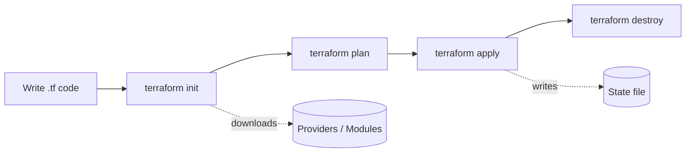

# 🌍 Terraform Fundamentals - Assignment 5

Hands-on practice with HashiCorp's official **AWS Get Started** Terraform tutorials, run in my own AWS Free Tier account. Every lab has its own folder and follows the same workflow: `init` → `plan` → `apply` → `destroy`.


## 📑 Table of contents

1. [Overview](#-overview)
2. [Tutorials completed](#-tutorials-completed)
3. [Repository structure](#-repository-structure)
4. [Terraform workflow](#-terraform-workflow)
5. [Lab details](#-lab-details)
6. [Useful commands](#-useful-commands)
7. [Problems I faced](#-problems-i-faced-and-how-i-fixed-them)
8. [Security and cost control](#-security-and-cost-control)

---

## 🔎 Overview

| Item | Details |
|---|---|
| Tool | Terraform v1.15.8 |
| Language | HCL (HashiCorp Configuration Language) |
| Cloud | AWS Free Tier |
| Region | `ap-south-1` (Mumbai) |
| Provider | `hashicorp/aws` v5.100.0 (constraint `~> 5.x`) |
| AMI | Ubuntu 24.04 LTS, found with a `data` block (Canonical, owner `099720109477`) |
| Instance type | `t3.micro` |
| Remote state | Amazon S3 bucket with versioning and `use_lockfile = true` |
| Registry module | `terraform-aws-modules/vpc/aws` |
| Credentials | Set with `aws configure` (never stored in this repo) |

---

## ✅ Tutorials completed

| # | Tutorial | Folder | Type |
|---|---|---|---|
| 1 | What is Infrastructure as Code with Terraform? | (concept, no code) | Mandatory |
| 2 | Install Terraform | (setup, no code) | Mandatory |
| 3 | Build Infrastructure | `Labs/lab1_create-infra` | Mandatory |
| 4 | Change Infrastructure | `Labs/lab2_change-infra` | Mandatory |
| 5 | Destroy Infrastructure | `Labs/lab3_destroy-infra` | Mandatory |
| 6 | Define Input Variables | `Labs/lab4_input_variable` | Mandatory |
| 7 | Query Data with Outputs | `Labs/lab5_output_variable` | Mandatory |
| 8 | Store Remote State (S3 Backend) | `Labs/lab6_remote_state_s3` | Mandatory |
| 9 | Create a Terraform Module | `Labs/lab7_create_module` | Recommended |
| 10 | Use Modules from the Registry | `Labs/lab8_registry_module` | Recommended |
| 11 | Manage Terraform Versions and Providers | `Labs/lab9_manage_version-provider` | Recommended |

---

## 📁 Repository structure

```
Terraform-Assignment-hashic/
├── .gitignore
├── README.md
└── Labs/
    ├── lab1_create-infra/             (Tutorial 3  - Build Infrastructure)
    ├── lab2_change-infra/             (Tutorial 4  - Change Infrastructure)
    ├── lab3_destroy-infra/            (Tutorial 5  - Destroy Infrastructure)
    ├── lab4_input_variable/           (Tutorial 6  - Input Variables)
    ├── lab5_output_variable/          (Tutorial 7  - Outputs)
    ├── lab6_remote_state_s3/          (Tutorial 8  - Remote State, S3 backend)
    ├── lab7_create_module/            (Tutorial 9  - Create a Module)
    ├── lab8_registry_module/          (Tutorial 10 - Registry Modules)
    └── lab9_manage_version-provider/  (Tutorial 11 - Versions and Providers)
```

Tutorials 1 and 2 are concept and installation tutorials, so they have no code folder.

---

## 🔄 Terraform workflow



| Step | What it does |
|---|---|
| `init` | Downloads the provider and modules, sets up the backend |
| `plan` | Previews what will be created, changed or destroyed |
| `apply` | Creates or updates the real AWS resources |
| `destroy` | Removes everything Terraform created |

---

## 🧪 Lab details

### 1️⃣ What is Infrastructure as Code with Terraform
- **Type:** Concept tutorial (no code)
- **💡 Key learning:** Infrastructure as Code means describing servers and networks in text files instead of clicking in the console, so the setup is repeatable, reviewable and can be kept in Git.

### 2️⃣ Install Terraform
- **Type:** Setup tutorial (no code)
- **What I did:** Installed Terraform and verified it with `terraform -version`, and checked AWS access with `aws sts get-caller-identity`.
- **💡 Key learning:** Terraform is one command-line tool that talks to cloud providers through plugins.

### 3️⃣ Build Infrastructure - `lab1_create-infra`
- **What it does:** Creates one EC2 instance (Ubuntu 24.04, `t3.micro`) with the tag `Name = learn-terraform`.
- **Files:** `terraform.tf`, `main.tf`
- **Result:** `Apply complete! Resources: 1 added.`
- **💡 Key learning:** `init` downloads the provider, `plan` previews and `apply` creates. The `data` block finds the latest Ubuntu AMI, so I don't hardcode an AMI ID.

### 4️⃣ Change Infrastructure - `lab2_change-infra`
- **What it does:** Creates the instance, then I change the `Name` tag to `learn-terraform-updated` and apply again.
- **Result:** Second apply shows `1 changed` (in-place update, same instance ID).
- **💡 Key learning:** Terraform compares my code with the real infrastructure and changes only the difference.

### 5️⃣ Destroy Infrastructure - `lab3_destroy-infra`
- **What it does:** Creates the instance, previews with `terraform plan -destroy`, then removes it with `terraform destroy`.
- **Result:** `Destroy complete! Resources: 1 destroyed.` and the instance shows as *Terminated* in the console.
- **💡 Key learning:** `destroy` removes everything Terraform created, which keeps the account clean and avoids charges.

### 6️⃣ Define Input Variables - `lab4_input_variable`
- **What it does:** The instance name and type come from variables in `variables.tf`. I overrode one with `terraform apply -var "instance_name=my-custom-name"`.
- **Result:** `0 added, 1 changed` - same instance ID, new tag.
- **💡 Key learning:** Variables make the same code reusable with different values, and `-var` changes a value without editing the resource.

### 7️⃣ Query Data with Outputs - `lab5_output_variable`
- **What it does:** `outputs.tf` prints the instance ID after apply.
- **Run:** `terraform apply`, `terraform output`, `terraform output instance_id`
- **💡 Key learning:** Outputs show useful values right after apply, so I don't have to search the console, and they can be passed to modules.

### 8️⃣ Store Remote State (S3 Backend) - `lab6_remote_state_s3`
- **What it does:** Stores the state file in an S3 bucket instead of my laptop, using S3 native locking.
- **Backend block (`terraform.tf`):**

```hcl
terraform {
  required_version = ">= 1.10"

  backend "s3" {
    bucket       = "<your-unique-bucket-name>"
    key          = "learn-terraform/terraform.tfstate"
    region       = "ap-south-1"
    encrypt      = true
    use_lockfile = true
  }
}
```

- **Bucket setup (must exist before `terraform init`):**

```
aws s3api create-bucket --bucket <your-unique-bucket-name> --region ap-south-1 --create-bucket-configuration LocationConstraint=ap-south-1
aws s3api put-bucket-versioning --bucket <your-unique-bucket-name> --versioning-configuration Status=Enabled
```

- **Result:** State file appears in the bucket at `learn-terraform/terraform.tfstate`; no local `terraform.tfstate` is created.
- **💡 Key learning:** Remote state is safer and shareable compared to a file on my laptop. Versioning allows recovery, and locking stops two runs from changing the state at the same time. Terraform does not create the backend bucket itself, it must exist first.

### 9️⃣ Create a Terraform Module - `lab7_create_module`
- **What it does:** Moves the EC2 code into `modules/ec2-instance` and calls it from the root with `module "web_server"`.
- **💡 Key learning:** A module groups resources into reusable code that takes inputs (variables) and returns outputs, so I don't repeat the same blocks.

### 🔟 Use Modules from the Registry - `lab8_registry_module`
- **What it does:** Uses the public `terraform-aws-modules/vpc/aws` module to create a VPC and subnets across `ap-south-1a`, `ap-south-1b` and `ap-south-1c`.
- **💡 Key learning:** Registry modules give ready-made infrastructure, so I only set the inputs instead of writing every resource.

### 1️⃣1️⃣ Manage Terraform Versions and Providers - `lab9_manage_version-provider`
- **What it does:** Shows how `required_version` and the provider `version` constraint control what is allowed.
- **Run:** `terraform version`, `terraform providers`, and a test with `required_version = ">= 99.0"` which makes `terraform validate` fail with an unsupported version error.
- **💡 Key learning:** The constraint is the allowed range, the installed version is what actually ran (provider `5.100.0`), and `.terraform.lock.hcl` locks that exact version so every machine gets the same result.

---

## 🛠️ Useful commands

| Command | What it does |
|---|---|
| `terraform init` | Downloads providers and modules, sets up the backend |
| `terraform fmt` | Formats the code |
| `terraform validate` | Checks the code for errors |
| `terraform plan` | Previews the changes |
| `terraform plan -destroy` | Previews what `destroy` would delete |
| `terraform apply` | Creates or updates resources |
| `terraform destroy` | Deletes resources |
| `terraform state list` | Lists the resources Terraform tracks |
| `terraform output` | Prints the output values |
| `terraform version` | Shows Terraform and provider versions |
| `terraform providers` | Shows which providers the configuration uses |

---

## 🐞 Problems I faced and how I fixed them

| Problem | Cause | Fix |
|---|---|---|
| `NoSuchBucket` on `terraform init` (lab 6) | The S3 bucket named in the `backend` block did not exist yet | Created the bucket with `aws s3api create-bucket` first, using a globally unique name, then ran `init` again |
| `BucketAlreadyExists` (possible) | S3 bucket names are global | Choose a more unique name and use the same name in the CLI commands and in `terraform.tf` |
| `-- More --` stuck in terminal | AWS CLI pager on long output | Press `q`, or use `--query` and `--output table` |

---

## 🔐 Security and cost control

- AWS access keys are **not** stored in this repo (they are set with `aws configure`).
- `.gitignore` excludes `.terraform/`, `*.tfstate`, `*.tfstate.*`, `*.tfvars`, `*.pem`, `*.key` and `.env`.
- `.terraform.lock.hcl` **is** committed because it only holds version information.
- `terraform destroy` was run after every lab so no resources are left running.
